# Pole Dance Easy Learning

An online pole dance school where adults learn pole elements at their own pace.
Every element has an illustration and is explained with the official IPSF Code of Points criteria.

- **Live site:** https://pole-dance-easy-learning.vercel.app
- **Repository:** https://github.com/alakhmakova/pole-dance-easy-learning

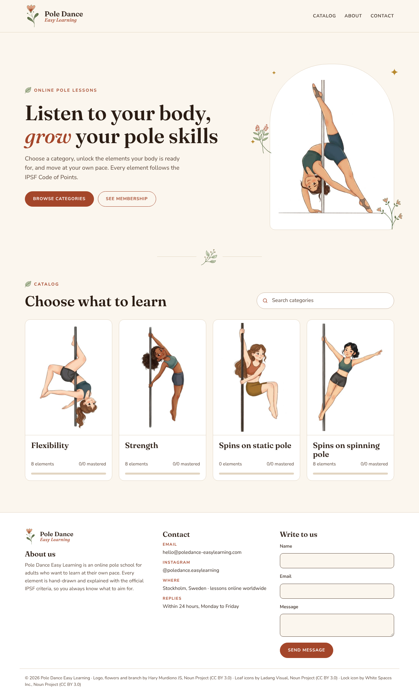

## The business

| | |
| --- | --- |
| **Name** | Pole Dance Easy Learning |
| **Type** | Online school: pole dance lessons sold element by element |
| **Target customers** | Adults who train pole dance in a studio or at home and want to learn new elements step by step, at their own pace |
| **Problem it solves** | Students often do not know which elements their body is ready for and what exactly makes an element "done". The site groups the elements by category and difficulty and shows the official criteria for each one |
| **Services and products** | Single elements (€4 each) in four categories: Flexibility, Strength, Spins on static pole, Spins on spinning pole. A membership for all categories is planned |

## Main features

- **Catalog** of categories with a search by name and a progress bar for each category.
- **Category page** with a table of elements: picture, tech value, difficulty level (Beginner, Intermediate,
  Advanced, shown with leaves), search by name and a filter by level.
- **Buying an element** and **marking it as mastered.** There is no payment yet: progress is saved in the browser (`localStorage`).
- **Element page** (only for bought elements): big picture, description, IPSF criteria,
  a "Mastered" button and links to the previous and next element.
- **Counters** that update at once: "2 / 4 mastered of the elements you own" on the category page and on the catalog cards.
- **Loading, error and empty states** for every page that loads data.
- **Responsive layout** for desktop, tablet and phone, with a menu button on small screens.
- **About and Contact** in the footer, reachable from the header links on every page.

## Technologies

- **React 19** (components, props, state, effects, conditional rendering)
- **React Router** (`BrowserRouter`, `Routes`, `Link`, `Navigate`, `useParams`)
- **Vite** (development server and build)
- **JavaScript:** `fetch` with `async`/`await`, `Promise.all`, array methods (`map`, `filter`, `find`, `findIndex`, `includes`), `localStorage`
- **HTML5** (semantic tags: `header`, `main`, `section`, `nav`, `footer`, `table`) and **CSS3** (Grid, Flexbox, media queries, custom properties), one CSS file per component
- **ESLint**
- **Vercel** for deployment

## Getting started

You need [Node.js](https://nodejs.org/en) (version 20.19 or newer).

```bash
git clone https://github.com/alakhmakova/pole-dance-easy-learning.git
cd pole-dance-easy-learning
npm install
npm run dev
```

Open the address that Vite prints, usually http://localhost:5173.

Other commands:

| Command | What it does |
| --- | --- |
| `npm run build` | Builds the site into the `dist` folder |
| `npm run preview` | Opens the built site locally |
| `npm run lint` | Checks the code with ESLint |

## Project structure

```text
public/
  data/            categories.json and elements.json: the content of the site
  images/          category and element pictures (their paths are written in the JSON files)
src/
  assets/images/   logo, leaves, flowers and other decorations imported by components
  components/      reusable parts: Header, Footer, Hero, CategoryCard, ElementRow, SearchBox, Filters...
  pages/           CatalogPage, CategoryPage, ElementPage (one per route)
  api.js           loads the JSON data with fetch
  storage.js       reads and saves bought and mastered elements in localStorage
  utils.js         small shared helpers: difficulty level, search match
  App.jsx          the routes of the site
docs/              learning log, routing notes, screenshots
```

## Screenshots

### Page states

Every page loads its data from JSON files, so every page goes through the same states.
They are always listed in this order:

1. **Loading:** the data is on its way.
2. **Could not be loaded:** a JSON file did not arrive (no internet, server error, wrong path).
3. **Not found:** the address has an id that does not exist.
4. **Empty:** the data arrived, but there is nothing to show yet.
5. **Loaded:** the normal page.
6. **After the user's actions** on this page: search, level filter, Mastered.

"—" means that the state does not exist on this page.

#### Catalog (home page, `/`)

| # | State | When | Screenshot |
| --- | --- | --- | --- |
| 1 | Loading | `categories.json` and `elements.json` are loading | 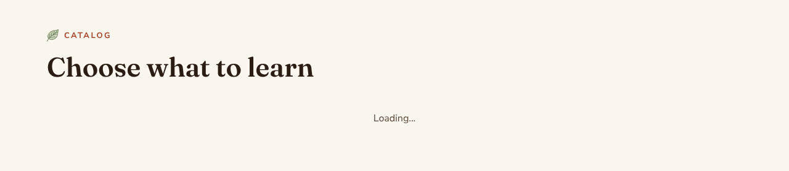 |
| 2 | Could not be loaded | one of the files did not arrive | 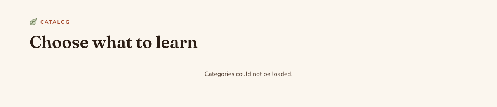 |
| 3 | Not found | — the catalog address has no id | — |
| 4 | Empty | `categories.json` is an empty list | 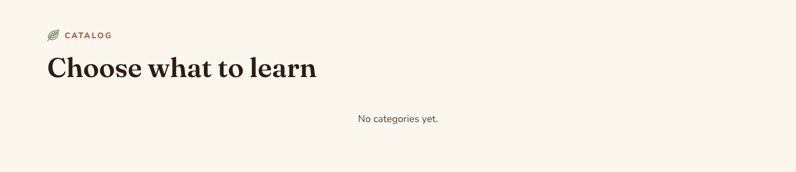 |
| 5 | Loaded | cards with the number of elements, mastered of owned, and a progress bar | 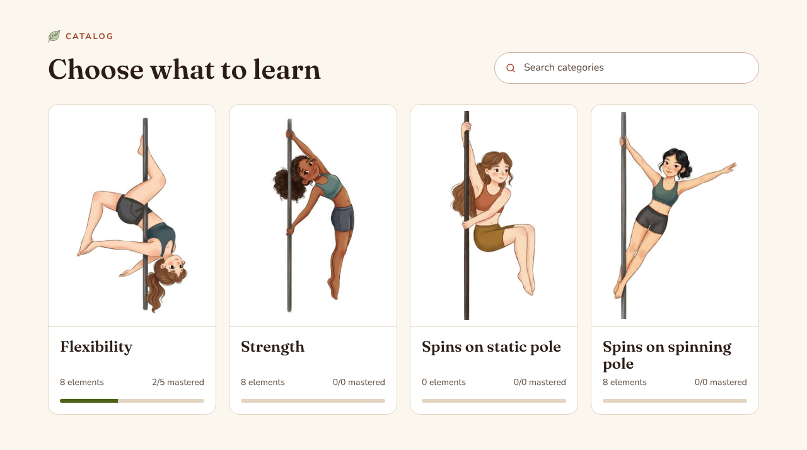 |
| 6a | Search | only categories whose name contains the text, here "spin" | 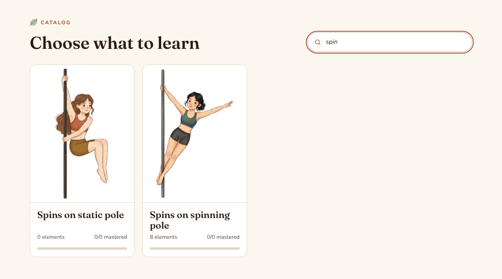 |
| 6b | Search: no results | no category name contains the text | 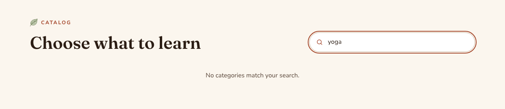 |

#### Category page (`/category/:id`)

| # | State | When | Screenshot |
| --- | --- | --- | --- |
| 1 | Loading | the category and its elements are loading | 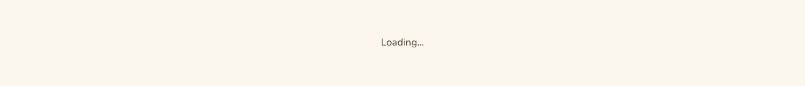 |
| 2 | Could not be loaded | one of the files did not arrive | 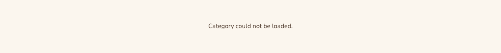 |
| 3 | Not found | no category with this id, for example `/category/yoga` |  |
| 4 | Empty | the category has no elements yet (Spins on static pole) | 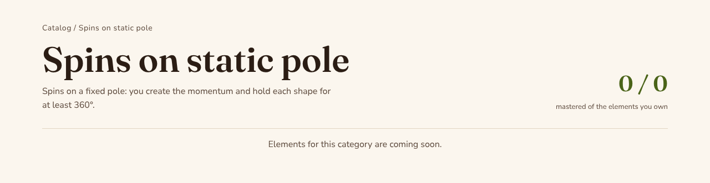 |
| 5 | Loaded | table of elements: bought ones have a Mastered checkbox, the others a lock and a Buy button; progress "2 / 5" in the header | 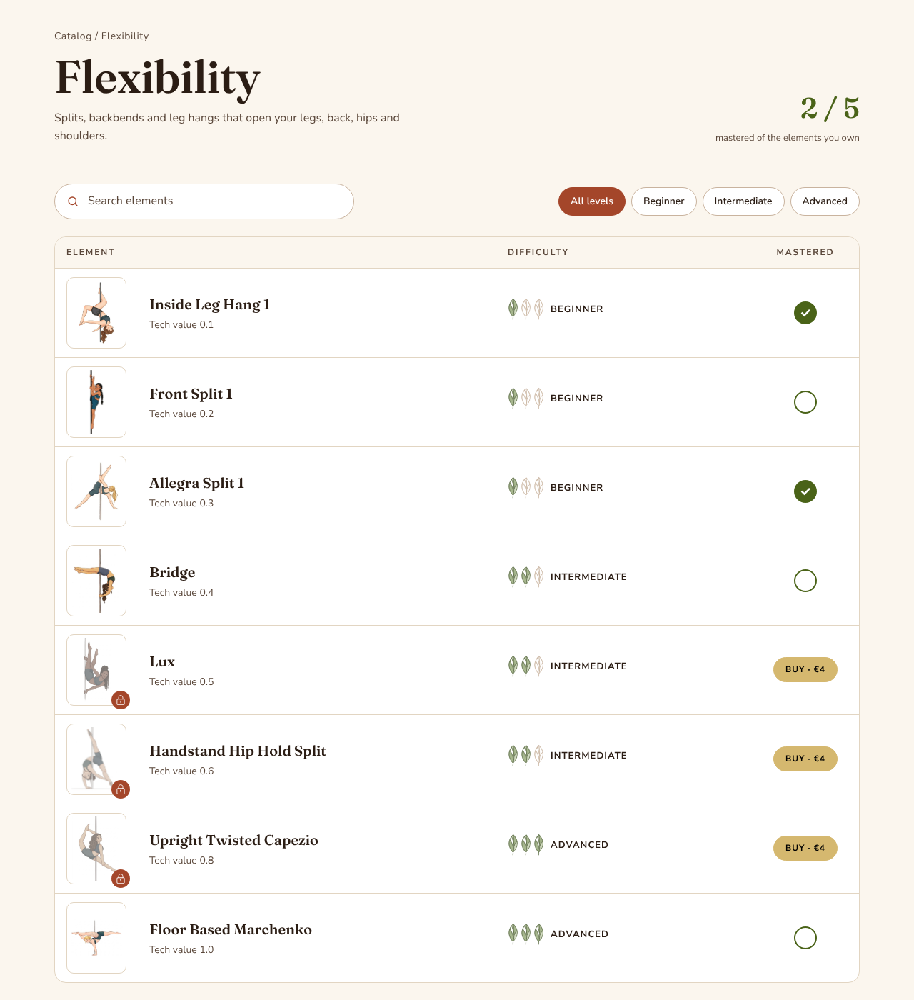 |
| 6a | Search | only elements whose name contains the text, here "split" | 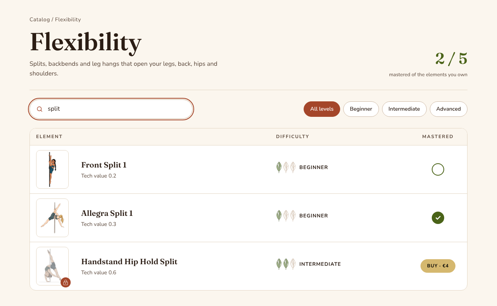 |
| 6b | Level filter | only elements of the chosen level, here Intermediate | 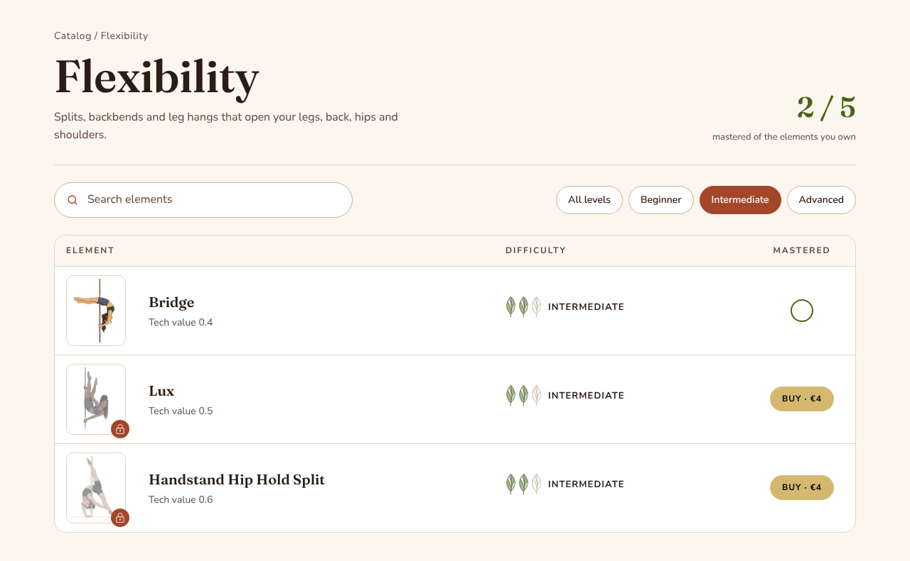 |
| 6c | Search or filter: no results | no element matches the search text and the level | 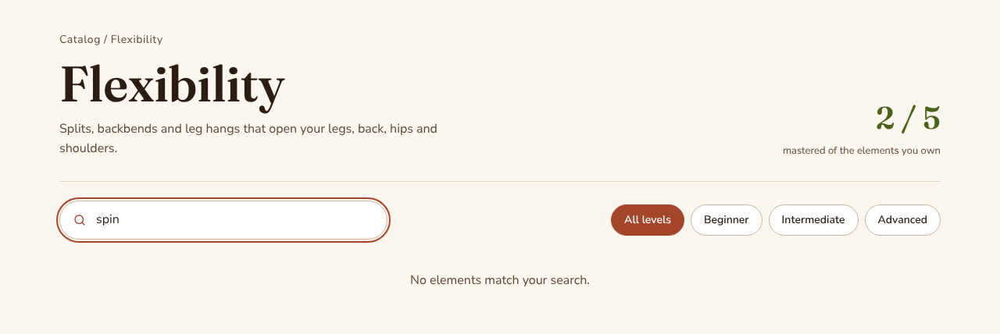 |

#### Element page (`/element/:id`)

| # | State | When | Screenshot |
| --- | --- | --- | --- |
| 1 | Loading | the categories and elements are loading |  |
| 2 | Could not be loaded | one of the files did not arrive | 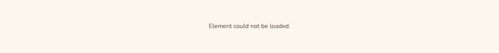 |
| 3a | Not found: element | no element with this id, for example `/element/X999` | 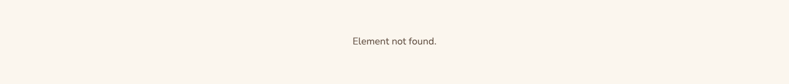 |
| 3b | Not found: category | the element exists, but its category is missing in `categories.json` | 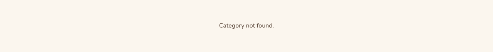 |
| 3c | Not bought | the element exists but is not bought: the page sends the visitor to the category page (`Navigate`), so this state has no screen of its own | — |
| 4 | Empty | — an element page always shows one element | — |
| 5 | Loaded | picture, description, IPSF criteria, "Mark as mastered", links to the previous and next bought element | 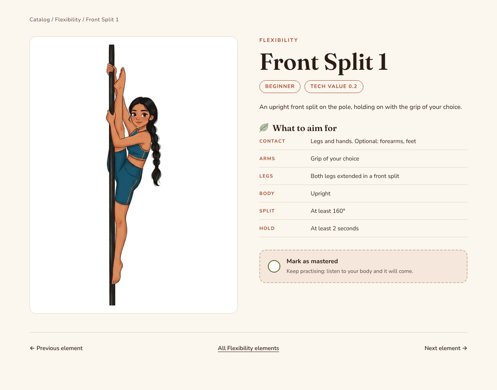 |
| 6a | Mastered | after a click on "Mark as mastered"; a second click undoes it | 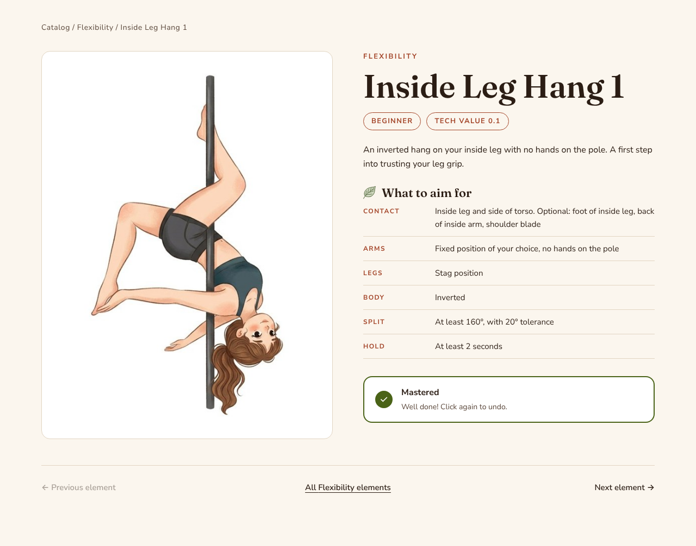 |
| 6b | Landscape picture | a picture wider than tall gets the full width, and the text goes under it in two columns | 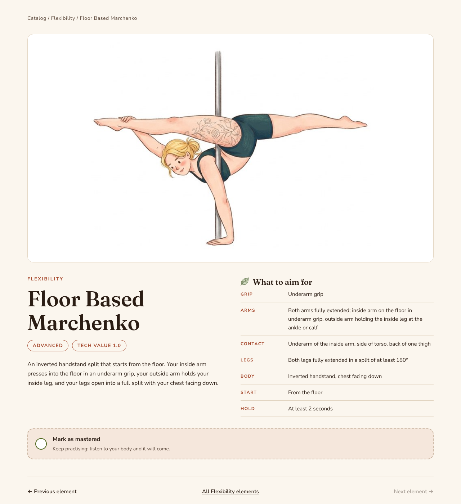 |

## Planning and how I worked

### Site map

```text
Home (/)                      hero + catalog of categories
├── Category (/category/:id)  table of elements, search, level filter, buy, mastered
│   └── Element (/element/:id) only for bought elements
└── About, Contact            sections in the footer of every page (#about, #contact)
```

### Design

- **Main colors:**

  | Color | Hex | Used for |
  | --- | --- | --- |
  | Cream | `#FBF6EE` | page background |
  | Dark brown | `#2B1D14` | text |
  | Terracotta | `#A4462A` | buttons, links, small headings |
  | Olive | `#4A6318` | mastered elements and progress |
  | Muted gold | `#D5B86F` | Buy buttons with prices |

  All text colors pass WCAG AA contrast.
- **Fonts:** Fraunces for headings, Nunito Sans for text.
- **Pictures are never cropped** (`object-fit: contain`), because the whole body position matters in pole dance.
  Element pictures can be portrait (taller than wide) or landscape (wider than tall), so the element page
  adapts to the picture: when the picture has loaded, the page compares its real width and height.
  A portrait picture stands next to the text, a landscape picture takes the full width and the text goes
  under it (see the element page states 5 and 6b above).

### Working together with AI

Time was limited: this course has four projects in about three weeks, and I learn the technologies
at the same time as I write the projects. So I decided to share the work with AI, and set myself
one clear goal: **learn the basics of React by building this project.**

1. **Mockup.** I described my whole idea to AI and asked it to make a mockup. Then I changed the mockup
   several times, until it looked the way I really wanted, not just the way AI first suggested.
2. **A guided project instead of copying.** When the mockup was ready, I explained to AI that I did not want
   to copy code from the mockup. I wanted to understand how a React project is built. So AI gave me tasks,
   one by one:
   - first, a piece of theory to read, so that I understand what to do and why I write it;
   - then I wrote that piece of code myself, based on what I had read;
   - then AI checked my code, helped me fix mistakes and explained what I did not understand;
   - only in a real dead end did I ask AI to write the piece of code for me, explain it,
     and give me theory to read, so that I understand that code too.

   The [learning log](docs/learning-log.md) records what I learned behind each commit.
3. **Priorities.** Not every part of the code is written by me. My teacher said that it is impossible
   to learn everything at once and it is better to focus on one thing. My focus was React, not CSS.
   - **CSS** I left fully to AI. I know CSS from my earlier studies at a vocational school (yrkeshögskola), could write
     at least 70% of it myself and understand what happens in my CSS files, but it still takes me a lot of
     time, so it was not my priority in this project.
   - **Sections with only markup and styles**, with no state, calculations or data loading
     (for example the hero section and the decorations), were also made by AI to save time.
   - **I focused on the parts that teach the important React concepts**, where there is logic,
     not only markup and styles. For example:
     - the structure of a component, `export` / `import` and splitting the site into reusable components;
     - **props:** passing data and callback functions from a page to `CategoryCard`, `ElementRow`, `SearchBox`, `Filters`;
     - **state with `useState`:** the search text, the selected level, bought and mastered elements;
     - **events:** `onClick` and `onChange` handlers, and why a handler needs an arrow function;
     - **`useEffect` and `fetch`:** loading the JSON data with `async`/`await` and `Promise.all`,
       with loading, error and "not found" states;
     - **`localStorage`:** saving and reading bought and mastered elements (`storage.js`);
     - **conditional rendering:** a ternary for Buy button or Mastered checkbox, and for an empty search result;
     - **array methods:** `filter` and `includes` for search and level filter, `find` for one element,
       `findIndex` for previous / next element, counting owned and mastered elements;
     - **routing:** routes with a parameter (`/category/:id`), `useParams`, `Link` and `Navigate`.

## What's next

As a project for learning the basics of React, I consider this project done. As a real website for
a business it is far from finished, and much more can be added. I keep my plans for the future of
the site in a separate document.

**Next step: an admin part (Project 4).** If this were a real business, the owner would not edit
the code to add new elements, categories or texts. The owner needs a convenient interface to fill
the site with content. Building this admin part is my next step and my next school project.

## Credits

- Illustrations of the pole elements and categories: generated by me with Google Gemini.
- Logo, flowers and branch by Hary Murdiono JS, leaf icons by Ladang Visual, lock icon by White Spaces Inc.,
  all from [Noun Project](https://thenounproject.com) (CC BY 3.0).
- Element criteria: IPSF Code of Points 2025–2027.

---

## How the code works

The sections below explain how the main features work in the code, step by step.

More documentation:

- [Routing: why BrowserRouter, and Link instead of a](docs/routing.md)
- [Learning log: documentation behind each commit](docs/learning-log.md)
- [Event handlers: passing a function, not calling it](docs/event-handlers.md)

## Buying elements and marking them as mastered

There is no payment and no user account yet. Progress is saved only in the
browser, in `localStorage` (code in `src/storage.js`).

- On a category page, click **Buy · €4**. The element counts as bought, and
  the button turns into a round **Mastered** checkbox.
- Tick the checkbox to mark the element as mastered, untick it to remove the
  mark. A bought element stays bought: as in a real shop, there is no button
  that cancels a purchase.

The browser keeps two lists of element ids:

| Key | Example value | Meaning |
| --- | --- | --- |
| `pole.owned` | `["F1","F4"]` | bought elements |
| `pole.mastered` | `["F1"]` | elements marked as mastered |

Each new id is added at the end, so the last id in a list is the latest
action. The ids are the `id` values in `public/data/elements.json`.

Progress belongs to one browser and one address: `localhost` and the Vercel
site have separate lists, and a private (incognito) window starts with none.

### Reset progress, for example before the next demo

**All progress:**

1. Open the site and press F12 to open the developer tools.
2. Chrome or Edge: tab **Application** → **Local storage** → the site's
   address. Firefox: tab **Storage** → **Local Storage** → the site's address.
3. Select `pole.owned` and press Delete. Do the same for `pole.mastered`.
4. Reload the page.

The same in one step: in the **Console** tab, run
`localStorage.removeItem("pole.owned"); localStorage.removeItem("pole.mastered");`
and reload the page.

**One element:** in the same list of keys, double-click the value of
`pole.owned` and remove that element's id, for example change `["F1","F4"]`
to `["F1"]`. Remove it from `pole.mastered` too, then reload the page.

### Where to find an element id

The page of a bought element shows its id in the address: `/element/F1` is
the element with the id `F1`. The text on the page shows only names, because
students don't need ids to buy or learn an element. For an element that is not
bought yet (it has no page), look the id up in `public/data/elements.json`.

## Opening an element page from the elements table

A bought element opens its own page (`/element/F1`) with a click anywhere in
its table row, except on the Mastered checkbox. Elements that are not bought
yet have no link: their rows are not clickable, and Buy works as before.

### Problems on the way and how they were solved

1. **The link opened the category id instead of the element id.**
   `ElementRow` used `useParams()`. `useParams` reads the parameters from the
   address of the *current page*. On `/category/flexibility` it returns the
   category id `flexibility`, and it knows nothing about a single row.
   **Solution:** take the id from the data the component already has in its
   props: `element.id`.
2. **The table layout broke.** `Link` was placed around the whole `tr`.
   `Link` becomes an `a` tag, and HTML allows only `tr` inside `tbody`, so the
   browser rebuilt the table and the rows fell apart. Wrapping every cell in
   its own link would give many links per row for keyboard and screen reader
   users. **Solution:** one link on the element name, inside its cell. For an
   element that is not bought, the name stays plain text (ternary on `owned`).
3. **Only the name was clickable,** but users also click the picture or empty
   space. **Solution:** a "stretched link" in `ElementRow.css`:
   - `tr` gets `position: relative`, so it becomes the frame for the link;
   - `a.el-name::after` is an empty, invisible layer with
     `position: absolute; inset: 0`, stretched over the whole row. It is part
     of the link, so a click on it opens the page;
   - the Buy button and the checkbox get `position: relative; z-index: 1`, so
     they lie above that layer and keep working without opening the page;
   - `tr:has(a.el-name:hover)` highlights a bought row under the mouse.

   No JavaScript is needed, the row is one link for the keyboard, and
   "Open in new tab" works.

### Two ways to get an id

| Where | How | Why |
| --- | --- | --- |
| Pages (`CategoryPage`, `ElementPage`) | `const { id } = useParams()` | The page must know *which* category or element to load, and that is written in the address (`category/:id`, `element/:id` in `App.jsx`). |
| Links (`ElementRow`, `CategoryCard`) | from the data in props: `` `/element/${element.id}` `` | The component already has the object it shows. It builds the address of the *next* page from it, not from the current address. |

Docs: [useParams](https://reactrouter.com/api/hooks/useParams),
[Link](https://reactrouter.com/api/components/Link),
[::after](https://developer.mozilla.org/en-US/docs/Web/CSS/::after),
[inset](https://developer.mozilla.org/en-US/docs/Web/CSS/inset),
[z-index](https://developer.mozilla.org/en-US/docs/Web/CSS/z-index),
[:has()](https://developer.mozilla.org/en-US/docs/Web/CSS/:has).

## How to trace the data: search, filters, buying, mastered and counts

Each chain below starts with what the user does and ends with what changes on
the screen. Read it from top to bottom; every step names the file and the
function, so you can open them in this order. One rule holds everywhere: the
**page** keeps the state (`useState`), the small components only show it and
report clicks through functions they get as props, and every list or number
on the screen is computed again on each render from that state.

### Search in the catalog

1. The user types in the field: `SearchBox.jsx`, `onChange={(event) => onChange(event.target.value)}`.
2. `onChange` is `setSearchText` from `CategoryList.jsx`, so the typed text goes into the state `searchText`.
3. The new state makes React render `CategoryList` again.
4. `visibleCategories = categories.filter(category => matchesSearch(category.name, searchText))`.
   `matchesSearch` (`src/utils.js`) compares in lower case and ignores spaces around the search text;
   an empty field matches every category.
5. `visibleCategories.map(...)` draws a `CategoryCard` for each one, or the text
   "No categories match your search." when the list is empty.

### Search and level filter on a category page

1. Typing works as in the catalog: `SearchBox` → `setSearchText` in `CategoryPage.jsx`.
2. A level button: `Filters.jsx`, `onClick={() => onChange('Beginner')}` (and so on for each level).
   `onChange` is `setLevel` from `CategoryPage.jsx`; the state `level` is `'All'` at the start.
3. `Filters` gets `selected={level}` back; the chosen button has `aria-pressed="true"` and is filled (`Filters.css`).
4. `visibleElements = elements.filter(element => matchesSearch(element.name, searchText) && (level === 'All' || getLevel(element.techValue) === level))`.
   Both conditions must be true; the parentheses are needed because `&&` runs before `||`.
5. `visibleElements.map(...)` draws an `ElementRow` for each one, or "No elements match your search.".
   The search field and the buttons stay on the page, so the user can change the search.

### Buying an element (owned)

1. The user clicks **Buy · €4**: `ElementRow.jsx`, `onClick={() => onBuy(element.id)}`.
2. `onBuy` is `handleBuy` in `CategoryPage.jsx`, which calls `setOwned(buyElement(elementId))`.
3. `buyElement(id)` in `src/storage.js` adds the id to the list `pole.owned` in `localStorage`
   (only once) and returns the new list.
4. `setOwned` puts the new list into the state `owned`, and the page renders again.
5. Each row gets `owned={owned.includes(element.id)}`. With `true`, the row shows the Mastered
   checkbox instead of the Buy button, the name becomes a link to `/element/<id>`, and the lock
   badge and the grey picture disappear.
6. The element page checks the same list: `ElementPage.jsx`, `getOwnedIds().includes(id)`.
   If the element is not bought, `<Navigate>` sends the user back to its category page.

### Marking an element as mastered

1. On a category page: the checkbox in `ElementRow.jsx`, `onChange={() => onToggleMastered(element.id)}`.
   On an element page: the Mastered button in `ElementPage.jsx`, `onClick={() => handleToggleMastered(element.id)}`.
2. `handleToggleMastered` (in `CategoryPage.jsx` and in `ElementPage.jsx`) calls `setMastered(toggleMastered(elementId))`.
3. `toggleMastered(id)` in `src/storage.js` removes the id from `pole.mastered` if it is there, adds it
   otherwise, saves the list and returns it.
4. The state `mastered` changes and the page renders again:
   - category page: each row gets `mastered={mastered.includes(element.id)}` (checkbox ticked or not);
   - element page: `isMastered = mastered.includes(element.id)` sets `aria-pressed` and the text of the button.

### Numbers on the screen

| Where | What is shown | How it is computed |
| --- | --- | --- |
| Catalog card | "8 elements" | `countElementsInCategory(category.id)` in `CategoryList.jsx`: elements of all categories (`getAllElements()`), filtered by `categoryId`, then `.length` |
| Catalog card | "1/3 mastered" | `countIdsInCategory(masteredIds, category.id)` / `countIdsInCategory(ownedIds, category.id)` in `CategoryList.jsx`: the category's elements whose id is in the list, then `.length`. The two lists are read once from `localStorage` with `getMasteredIds()` and `getOwnedIds()` |
| Catalog card | Olive progress bar | `masteredPercent` in `CategoryCard.jsx`: `Math.round(categoryMastered / categoryOwned * 100)`, or 0 when nothing is bought; it becomes the `width` of the olive part (`style={{ width: ... }}`) |
| Category page header | "1 / 3 mastered of the elements you own" | `masteredCount` and `ownedCount` in `CategoryPage.jsx`: `elements.filter(el => mastered.includes(el.id)).length` and the same with `owned`. `elements` already holds only this category (`getElements(id)` in `src/api.js`) |
| Table row, element page | Level: Beginner, Intermediate, Advanced | `getLevel(element.techValue)` in `src/utils.js`: up to 0.3 Beginner, up to 0.6 Intermediate, higher Advanced |
| Table row | Leaves before the level | `leafCount` in `ElementRow.jsx`: position of the level in `['Beginner', 'Intermediate', 'Advanced']` plus 1; that many filled leaves, the rest are outlines |
| Table row, element page | "Tech value 0.1" | `element.techValue` from `elements.json`; `toFixed(1)` always shows one decimal (1 becomes "1.0") |

Only bought elements have a checkbox, so a mastered element is always a bought
one, and "mastered" is never larger than "owned".

### Previous / next element on the element page

1. `ElementPage.jsx`: `ownedInCategory` = bought elements of the same category, in the order of `elements.json`
   (`elements.filter(el => el.categoryId === element.categoryId && ownedIds.includes(el.id))`).
2. `position = ownedInCategory.findIndex(el => el.id === element.id)`; `previousElement` and `nextElement`
   are the elements at `position - 1` and `position + 1`, or `undefined` at the start or the end of the list.
3. If there is a previous or next element, the pager shows a `Link` to `/element/<id>`; otherwise a pale
   text that cannot be clicked. The middle link goes back to the category page.
4. The address changes but the same page component stays open, so an Effect with `[id]` calls
   `window.scrollTo(0, 0)` to show the new element from the top.

### Wide (landscape) pictures on the element page

1. `ElementPage.jsx`: the picture has `onLoad={(event) => setWide(event.target.naturalWidth > event.target.naturalHeight)}`.
   `naturalWidth` and `naturalHeight` are the real size of the image file.
2. `wide` becomes `true` for a landscape picture, and `div.el-wrap` gets the class `wide`.
3. `ElementPage.css`, rules `.el-wrap.wide`: the picture takes the full width, the text goes into two columns under it.

## Ways to move between pages and places on a page

The site uses several kinds of links. Each one does a different job.

| Kind | Where in the code | What happens | Page reloads? |
| --- | --- | --- | --- |
| `<Link to="/...">` from `react-router` | category cards, element names in the table, breadcrumbs, logo, Previous / next element | Opens another page of the site (another route) | No, React only swaps the page component |
| `<Navigate to="..." replace />` from `react-router` | `ElementPage.jsx`, element that is not bought | Sends the visitor to another page by itself, without a click | No |
| `<a href="#id">` (hash link) | "Browse categories" in the hero (`#catalog`), "About" and "Contact" in the header (`#about`, `#contact`) | Scrolls to the element with that `id` on the same page | No |
| `window.scrollTo(0, 0)` in an Effect | `ElementPage.jsx`, when `id` changes | JavaScript scrolls the page to the top | No |

### Link and Navigate: other pages of the site

- `Link` is written like `<Link to="/category/flexibility">`. In the browser it becomes a normal `<a>`,
  but React Router stops the reload and only shows the new page component. A plain `<a href="/category/flexibility">`
  would load the whole site again, so links between pages of the site always use `Link`.
- `Navigate` is a component, not a link. When React draws it, the address changes at once.
  `replace` means the old address is replaced in the history, so the Back button does not return
  to the locked element and send the visitor away again.

### Hash links: a place on the same page

1. The link has `href="#catalog"`. The `#` means "not a new page, a place on this page".
2. The target has `id="catalog"` (`<section id="catalog">` in `CatalogPage.jsx`).
3. On click the browser finds the element with this `id` and scrolls to it. No JavaScript is needed.
4. `index.css`: `html { scroll-behavior: smooth; }` makes the scroll smooth. It is inside
   `@media (prefers-reduced-motion: no-preference)`, so visitors who turned off animations in their
   system get a jump instead of a moving page.
5. "About" and "Contact" work from every page, because the footer with `#about` and `#contact` is on every page.
   `#catalog` exists only on the home page.

### Scrolling with JavaScript

- `window.scrollTo(0, 0)` scrolls the whole window to the top. The element page uses it because
  Previous / next keeps the same page component open, and the browser would stay at the old scroll position.
- Not used yet: `element.scrollIntoView({ behavior: 'smooth' })` scrolls to one element after some action
  (for example after a form is sent). In React the element is usually found with `useRef`.

Read more: [Link](https://reactrouter.com/api/components/Link), [Navigate](https://reactrouter.com/api/components/Navigate),
[scroll-behavior](https://developer.mozilla.org/en-US/docs/Web/CSS/scroll-behavior),
[scrollIntoView](https://developer.mozilla.org/en-US/docs/Web/API/Element/scrollIntoView),
[scrollTo](https://developer.mozilla.org/en-US/docs/Web/API/Window/scrollTo).

## Development notes

- **StrictMode** (in `src/main.jsx`) is a React helper for development only. It shows nothing on the page. It runs components and effects twice on purpose, so bugs show up early. That is why in `npm run dev` the browser console can show the same log or error twice and `categories.json` is requested twice. The built site (Vercel) is not affected. [React docs: StrictMode](https://react.dev/reference/react/StrictMode)
- **vercel.json** tells Vercel to return `index.html` for every address. The site uses BrowserRouter, so pages like `/category/flexibility` exist only inside React, not as files on the server. Without this rule, refreshing such a page or opening its link directly would give a 404 error. In `npm run dev` Vite does this by itself. More in [docs/routing.md](docs/routing.md).
